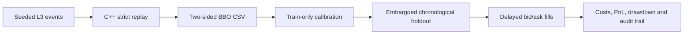

# C++ Order Book & Microstructure Research Lab

[](https://github.com/AshishTho/C-Order-Book/actions/workflows/ci.yml)

**From order events to execution-aware research.** A C++20 matching engine,
strict event replay, and a dependency-free Python lab for testing whether
order-book signals survive delayed execution, spread, fees, and finite depth.

The project connects three questions:

- **Developer:** Can the engine preserve price/time priority, quantities, and
  order lifecycles under malformed inputs and randomized workloads?
- **Researcher:** Does a signal generalize to a chronological holdout without
  fitting its direction or threshold on future observations?
- **Trader:** What remains after crossing the spread, paying fees, delaying
  entry, and limiting fills to displayed liquidity?

This is a research and systems project. The bundled data is **synthetic**;
the implementation does not establish live tradable alpha or production readiness.

An optional, offline [Leakage Lab syntax check](research/LEAKAGE_CHECK.md) flags
literal negative row shifts and centered fixed row windows for review. These
limited heuristics never execute scanned code and do not certify a backtest as
free of leakage.

[Repro Capsule](research/REPRO_CAPSULE.md) previews manually supplied commands,
logs and diffs before creating a local JSON evidence report. It flags some
possible secrets and never collects files, executes commands or uploads reports.

An optional [walk-forward protocol](research/WALK_FORWARD.md) evaluates fixed inputs
on successive future blocks and reuses the recorded replay inspector for one fold.
The [trading backlog](docs/TRADING_BACKLOG.md) records the remaining bounded work.

## Reproduce the whole experiment

Requirements: CMake 3.16+, a C++20 compiler, Python 3.10+. No Python packages
or market-data credentials are needed. The existing RDTSC benchmarks target x86-64.

```sh
cmake -S . -B build -DCMAKE_BUILD_TYPE=Release
cmake --build build --config Release --parallel 2
ctest --test-dir build -C Release --output-on-failure
python scripts/run_study.py --build-dir build --output-dir build/study
```

For MinGW on Windows, add `-G "MinGW Makefiles"` to the configure command.
The script also finds Visual Studio executables under `build/Release`.
Use a fresh output directory for each study: existing results are preserved.

Open `build/study/report.html` for equity curves, model comparisons, cost
sensitivity, and assumptions. `report.json` contains the machine-readable
experiment, calibration, fills, and inventory. `manifest.json` records the
commands, input/output hashes, source fingerprint, binary hash, and runtime.



The default seed-42 fixture produces 10,000 events and 9,999 valid BBO
observations. In the checked-in [example result](examples/synthetic_summary.json),
all active strategies lose after spread and fees; the flat control stays at zero.
This is a plumbing and accounting test, **not a market result**. The generator
has artificial deep anchor quotes and is not calibrated to a real venue.

## What is implemented

**Matching and execution infrastructure.** Flat price ladder with a hierarchical
occupancy bitmap; intrusive FIFO queues; preallocated order arena;
generation-checked IDs; limit orders, partial fills, cancellation, reserve
reloads, and post-only rejection. Integer ticks and lots avoid decimal price
comparison ambiguity. The single writer owns all book mutation.

**Feed and risk components.** SPSC message and arena rings; an allocation-free
decoder for the A/E/X/D subset of length-framed ITCH 5.0; explicit parser error
status and byte offsets; sparse order-reference mapping; quantity, collar,
position, rate, and clock checks; mapped byte journaling with checked flushes.
These components also have standalone microbenchmarks.

**Signals and recovery.** Best bid/ask updates, top-of-book OFI, and a size-weighted
midpoint proxy with overflow-safe Q56.8 arithmetic. Snapshot messages retain
64-bit prices and aggregate sizes. Publishers retain the newest pending snapshot
when the ring is full and expose an explicit retry operation.

**Research.** Imbalance, weighted-midpoint displacement, and normalized OFI;
seeded random and flat controls; train-only direction and threshold calibration;
an embargo covering label horizon and execution delay; one position at a time;
depth-capped bid/ask fills; per-side fees and slippage; mark-to-market drawdown,
terminal inventory, transaction-cost and delay scenarios. There is no annualized
Sharpe derived from irregular event time and no claim of statistical significance.

## Evidence and tests

See the [recorded validation](docs/VALIDATION.md) for checked-in raw evidence
and the distinction between local checks and remote CI status.

```sh
# Linux: independent compiler + memory/undefined-behavior instrumentation
cmake -S . -B build-sanitize -DCMAKE_CXX_COMPILER=clang++ \
  -DCMAKE_BUILD_TYPE=Debug -DLOB_SANITIZERS=ON
cmake --build build-sanitize --parallel 2
ctest --test-dir build-sanitize --output-on-failure

# Capture repeated raw benchmark results and environment/build provenance
python scripts/benchmark.py --targets signals risk advanced_orders \
  --repeats 3 --output build/benchmark.json
```

- `tests/test_correctness.cpp`: 36,000 seeded differential operations against
  a simple reference book, four million cross-thread ring transfers, and
  targeted matching, priority, stale-ID, reserve, overflow, and risk cases.
- `tests/test_feed.cpp`: malformed/truncated/unaligned frames, exact signal
  arithmetic, empty-side transitions, queue backpressure, and journal corruption.
- `tests/test_replay.py`: a separate 3,000-event depth oracle, lifecycle checks,
  strict input rejection, and preservation of earlier output.
- `tests/test_research.py`: leakage boundaries, delayed fills, spread/fee
  accounting, depth limits, terminal inventory, reproducibility, and input checks.
- GitHub Actions builds GCC Release, Clang with ASan/UBSan, and Windows MSVC;
  each job runs tests and uploads a reproduced synthetic study.

`LOB_NATIVE=ON` opts into machine-specific instructions. It is off by default.
Benchmarks attempt affinity, report failure, and retain normal scheduling
priority. Desktop timing includes scheduling noise. The old README's latency
numbers lack committed raw evidence for the current implementation and are
not carried forward as current performance claims.

## Use your own data

The offline adapter accepts one instrument and one ordered session. Feed it
normalized order-level events, or pass an already reconstructed BBO CSV directly
to the research lab. Do not combine instruments or silently discard bad messages.

```sh
./build/replay_events --input events.csv --output bbo.csv --base-tick 0
python -m research.lab --input bbo.csv --output report.json --html report.html \
  --data-kind historical --horizon 10 --delay 1 --fee-ticks 0.1
```

On Windows use `build/replay_events.exe` or `build/Release/replay_events.exe`.
The `historical` flag is a provenance declaration, not data verification.
See [event and engine contracts](docs/DESIGN.md) and
[research methodology](research/METHODOLOGY.md) before interpreting results.

## Scope and next research steps

The flat ladder covers a configured 65,536-tick interval; the replay tool holds
at most 65,536 live orders. Matching costs grow with the orders and reserve
clips filled. Storage exhaustion, generation wrap, and rejected remainders
need explicit gateway policies. ITCH support is a subset, not a full exchange
feed handler. The journal has no power-loss/torn-write recovery guarantee.

The execution model has no queue-position model, passive fills, exchange
acknowledgements, market impact, borrow costs, or portfolio margin. It uses
observation delay rather than wall-clock latency. Historical multi-session
walk-forward studies, spread/depth regime analysis, and dependence-aware
uncertainty estimates are the next requirements before any alpha claim.

For a concise demonstration and defensible project talking points, see the
[interview guide](docs/INTERVIEW_GUIDE.md).

For explicit test boundaries, a reserved final suffix and independent cost,
delay, spread and depth cases, use the [walk-forward stress diagnostics](research/WALK_FORWARD_STRESS.md).
The existing scheduled walk-forward API remains available. [Repro Capsule](research/REPRO_CAPSULE.md)
also accepts manually declared experiment parameters and evidence hashes;
it does not verify those hashes against files or execute supplied commands.

## References

OFI follows the top-of-book event formulation in
[Cont, Kukanov & Stoikov, *The Price Impact of Order Book Events*](https://arxiv.org/abs/1011.6402).
The weighted midpoint is a proxy, not a fitted conditional microprice model.
Wire layouts are drawn from the
[Nasdaq TotalView–ITCH 5.0 specification](https://www.nasdaqtrader.com/content/technicalsupport/specifications/dataproducts/NQTVITCHSpecification_5.0.pdf).
